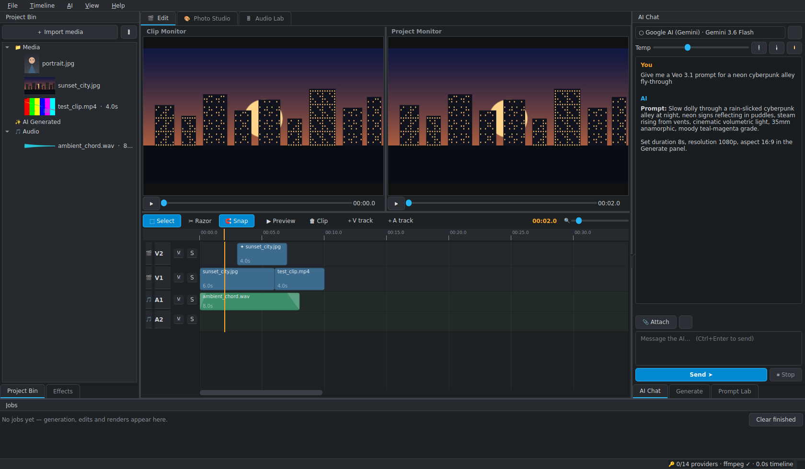
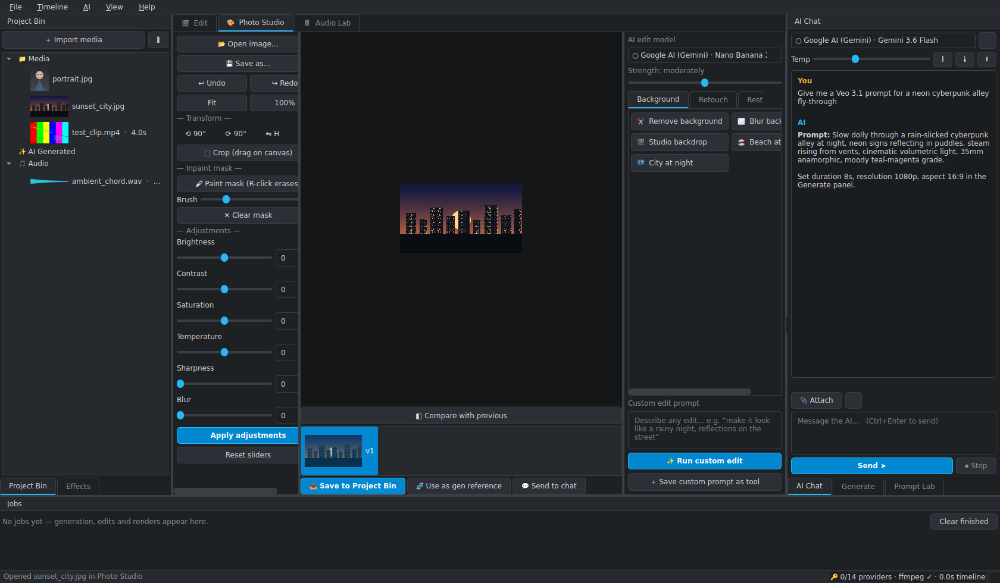
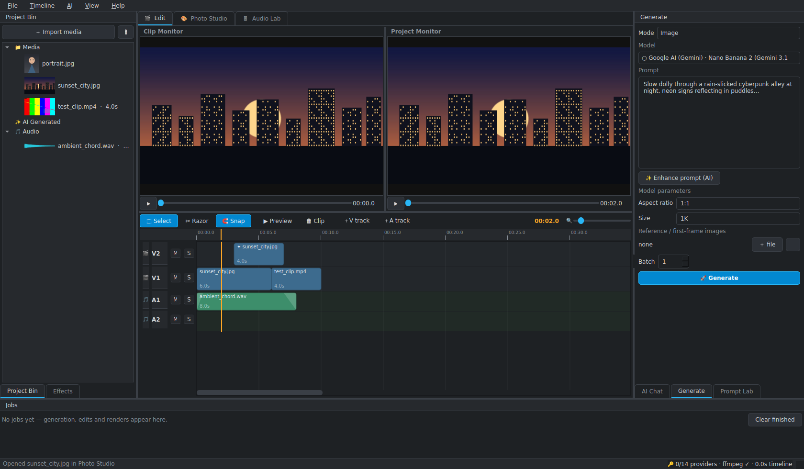

# PrismCut Studio — AI Photo, Video and Audio Editor

[](https://github.com/Arthurman70/prismcut-studio/releases/download/v1.8.3/PrismCut-Studio-Setup-1.8.3.exe) [](https://github.com/Arthurman70/prismcut-studio/releases/download/v1.8.3/PrismCut-windows-x64.zip)

[Product downloads](https://github.com/Arthurman70/prismcut-studio/releases) · [Screenshots](#screenshots) · [Source setup](#quick-start-from-source) · [FAQ](#frequently-asked-questions)

**Choose your version:** the published Windows packages are **v1.8.3**. The **1.9.0 source update**, including Muse, is on `main`; it has not yet been published as a GitHub installer. Provider API access and usage charges are separate from the app.

**Downloads and setup:** [Download Windows installer v1.8.3](https://github.com/Arthurman70/prismcut-studio/releases/download/v1.8.3/PrismCut-Studio-Setup-1.8.3.exe) · [Portable Windows ZIP](https://github.com/Arthurman70/prismcut-studio/releases/download/v1.8.3/PrismCut-windows-x64.zip)

**Open-source AI photo, video & audio studio — bring your own API keys.**

A native desktop app (Qt, ships as a Windows `.exe`) that fuses a
Kdenlive-style editing workflow with the latest generative AI APIs: chat with
any model, generate and edit images with one-click **Nano Banana** tools, render
video with **Veo / Sora / Grok Imagine / Hailuo / Seedance / Kling / Wan / LTX**, and
score it with **ElevenLabs / MiniMax / Suno** music — all from a multi-track
timeline with audio mixing and ffmpeg export.

## Screenshots





> UI layout inspired by the excellent [Kdenlive](https://kdenlive.org).
> Clean-room implementation — no Kdenlive code or assets are used, which is
> what lets PrismCut be MIT-licensed.

---

## Features

**Editing**
- Multi-track timeline (video V1/V2…, audio A1/A2…, add as many as you like) with drag, trim, razor, snapping, zoom, per-track mute/solo and a scrub preview player
- Dual monitors (clip / project), project bin with thumbnails and drag-and-drop import
- Per-clip effects rendered by ffmpeg on export: transform, opacity, color, blur, speed, plus audio gain/fades
- Export presets: 1080p / 4K / vertical / square, H.264, HEVC, VP9/WebM, GIF, PNG sequence, MP3/WAV audio mixdown
- Photo Studio: crop, rotate/flip, brightness/contrast/saturation/temperature/sharpen/blur, inpaint **mask brush**, version filmstrip with A/B wipe compare

**AI (bring your own keys — the app works with any subset)**
- **Nano Tools**: ~25 prefilled one-click AI edits (remove background, relight golden hour, restore old photo, colorize, magic eraser, cartoonify, product shot, outpaint…) that send your image + prompt to the selected edit model — Nano Banana by default; add your own tools without code
- **Generate panel**: text→image, text/image→video, music, SFX and speech with *full parameter control* — every model exposes its own tuned form (seed, aspect, resolution, duration, CFG, negative prompt, style presets, reference/first-frame images, batch variants)
- **Prompt Lab**: templates with `{variables}`, style-tuning token groups (lighting, lens, mood, color), live preview, prompt history, one-click "Enhance with AI"
- **AI Chat**: full chat panel with a model toggle populated from every configured provider, streaming responses, system prompt + temperature, saved conversations, and image/audio/video attachments encoded correctly per provider
- **Audio Lab**: mixer (faders/pan/mute/solo), waveforms, normalize, fades, plus AI TTS voices, music generation, sound effects and transcription straight into the bin

**Provider adapters (14 + custom)**

| Provider | Chat | Image gen | Image edit | Video | TTS | Music | SFX | STT |
|---|---|---|---|---|---|---|---|---|
| Google AI (Gemini · Nano Banana · Veo) | ✅ | ✅ | ✅ | ✅ | ✅ | — | — | ✅ |
| OpenAI (GPT · gpt-image · Sora 2) | ✅ | ✅ | ✅ | ✅ | ✅ | — | — | ✅ |
| Anthropic Claude | ✅ | — | — | — | — | — | — | — |
| Meta (Muse) | ✅ | ✅ | ✅ | — | — | — | — | ✅ |
| xAI (Grok · Grok Imagine) | ✅ | ✅ | ✅ | ✅ | — | — | — | — |
| DeepSeek | ✅ | — | — | — | — | — | — | — |
| MiniMax (Hailuo 03 "H3" · Music · Speech) | ✅ | — | — | ✅ | ✅ | ✅ | — | — |
| Seedance 2.0 (BytePlus Ark) | — | — | — | ✅ | — | — | — | — |
| Stability AI | — | ✅ | ✅ | — | — | — | — | — |
| Black Forest Labs (FLUX 2 · Kontext) | — | ✅ | ✅ | — | — | — | — | — |
| fal.ai (aggregator: Kling, WAN, LTX…) | — | ✅ | ✅ | ✅ | — | ✅ | — | — |
| Replicate (aggregator) | — | ✅ | — | ✅ | — | ✅ | — | — |
| ElevenLabs | — | — | — | — | ✅ | ✅ | ✅ | — |
| Suno (community gateway, experimental) | — | — | — | — | — | ✅ | — | — |
| Custom OpenAI-compatible (OpenRouter, Groq, Ollama…) | ✅ | — | — | — | — | — | — | — |

The October 22, 2026 update adds **36 model entries**, for **98 bundled models**.
These include Meta Muse, GPT-6 and GPT Image 2.5, Claude 5.5 / Fable,
Gemini 4 Argon / 3.8 Flash / Nano Banana 2.1, MiniMax M3 / Speech 2.8,
Grok 4.7 / Imagine Image 2.0, and fal-hosted Kling 3 / Seedance 2.5 / Wan 3 / LTX 2.5.
See [the model update notes](docs/model-update-20261022.md) for capabilities,
account requirements, sources and validation limits.

Model IDs and parameter presets live in `prismcut/assets/models.json`.
**AI ▸ Model Manager** now includes search by model, provider or capability,
and still supports custom entries and endpoint overrides. New IDs using an
existing API contract can be added without rebuilding; new API formats need
an adapter update. Existing choices and user overrides are retained.

---

## Quick start (from source)

```bash
git clone https://github.com/Arthurman70/prismcut-studio
cd prismcut-studio
python -m pip install -r requirements.txt
python -m prismcut
```

Requirements: Python 3.10+, [ffmpeg](https://ffmpeg.org/download.html) on PATH
for export/waveforms (`winget install Gyan.FFmpeg` on Windows). The app runs
without ffmpeg; export and waveforms are disabled until it is installed.

### Drop in your keys

Open **AI ▸ API Keys…** (Ctrl+K). Each provider row links to its key page —
paste the key, hit *Test*, done. Any subset works; panels only list models
whose capability exists, marking keyed providers with 🔑. Environment
variables (`GEMINI_API_KEY`, `OPENAI_API_KEY`, `XAI_API_KEY`,
`MODEL_API_KEY` (Meta Muse), `MINIMAX_API_KEY`, `FAL_KEY`, …) override stored keys.

> 🔒 Keys are stored locally (OS keyring when available, else app settings,
> obfuscated not encrypted) and are only ever sent to that provider's own API.
> The only other network call the app makes is an optional update check
> against GitHub's public Releases API (**Help ▸ Check for Updates…**, or
> automatically at most once every 24h if left enabled) — no personal data
> is sent, and it can be turned off in the same menu. It's open source —
> audit `providers/` and `core/updater.py`.

## Windows .exe

**Download:** grab `PrismCut-Studio-Setup-<version>.exe` from
[Releases](https://github.com/Arthurman70/prismcut-studio/releases) for a proper installer — Start Menu shortcut,
optional desktop icon, and a clean uninstall via *Apps & Features*. It
installs per-user, so no admin rights or UAC prompt are needed. A portable
`PrismCut-windows-x64.zip` (just unzip and run) is attached to the same
release for anyone who'd rather not install anything. Both are built
automatically by GitHub Actions on every tag — no toolchain needed.

**Build it yourself** on Windows (one command):

```bat
packaging\build_windows.bat
```

→ `dist\PrismCut\PrismCut.exe`. To also build the installer, grab
[Inno Setup 6](https://jrsoftware.org/isinfo.php) (free) and run:

```bat
"C:\Program Files (x86)\Inno Setup 6\ISCC.exe" packaging\installer.iss
```

→ `dist\installer\PrismCut-Studio-Setup-<version>.exe`. Or trigger the
*Build Windows EXE* workflow from the Actions tab and download the artifact.

---

## Architecture

```
prismcut/
├── core/          settings & key vault · model registry · job queue ·
│                  ffmpeg media probe/thumbs · project model · export renderer
├── providers/     one adapter per provider implementing a common contract:
│                  chat / generate_image / edit_image / generate_video /
│                  tts / music / sound_effect / transcribe  (Qt-free, testable)
├── ui/            Qt widgets: main window, timeline, monitors, project bin,
│                  Photo Studio + Nano Tools, Generate, Prompt Lab, Chat,
│                  Audio Lab, Effects, Jobs, dialogs (keys / models / export)
└── assets/        models.json · nano_tools.json · prompt_templates.json
```

- Everything long-running (API calls, polling, renders) runs in the **job
  queue** with progress + cancel — the UI never blocks.
- Media in/out is handled per provider: base64 inline data for Gemini,
  multipart for OpenAI edits/Whisper, data-URIs for fal/MiniMax first-frames,
  hex-decoding for MiniMax audio, signed-URL downloads for FLUX/Veo/Sora.
- Projects save as JSON (`.pcut`), media stays referenced in place; generated
  assets land in the app data dir and the bin's *AI Generated* group.

## Roadmap

Full-sequence realtime playback (compositing preview), keyframed effects,
proper LUFS loudness normalization, SRT/caption editor with per-segment
timings, per-clip pan law, proxy editing, plugin system for community
providers, macOS/Linux packages.

## Contributing

PRs welcome — see [CONTRIBUTING.md](CONTRIBUTING.md).
Provider adapters are ~100 lines each; adding one is a great first PR.

## License

[MIT](LICENSE). Kdenlive inspired the layout but no GPL code is used.
You pay AI providers directly at their rates; generated content is subject to
each provider's terms.

## Frequently asked questions

Answers describe this repository and its documented scope as of **October 23, 2026**.

### What is PrismCut Studio, and what can I make with it?

PrismCut Studio is a desktop photo, video and audio editor with optional AI tools. Combine clips on a multitrack timeline, edit photos, generate media through supported providers, and export finished work with FFmpeg. See the [feature list](#features) for the current editing and generation tools.

### Is PrismCut Studio free, or do I need an AI subscription?

The PrismCut application is MIT licensed. AI generation uses your own provider API keys, and those providers set their own pricing, access rules and quotas. An existing consumer chatbot subscription does not necessarily include API access. You can use the editing tools without configuring every provider.

### Where can I download the PrismCut Windows installer?

Use the Windows download button above or the [published releases](https://github.com/Arthurman70/prismcut-studio/releases). Choose the setup EXE for installation or the portable ZIP to unzip and run. The published installer is v1.8.3; the main branch contains the newer 1.9.0 model update. These are different versions.

### Does PrismCut support Meta Muse models?

The 1.9.0 source update includes a Meta adapter and Muse model entries. Configure the Meta key in **AI → API Keys**, or use `MODEL_API_KEY`. Available capabilities and model access depend on your provider account. See the [dated model update notes](docs/model-update-20261022.md), including their validation limits; the v1.8.3 download predates this update.

### Can I use Gemini, OpenAI, Claude, Grok and other providers in one app?

Yes. PrismCut includes separate provider adapters and a capability-based model picker. Providers support different combinations of chat, images, video, speech and music. The [provider table](#features) and [provider guide](PROVIDERS.md) explain those differences; adding an API key does not make every provider support every media type.

### Can I connect Ollama or another OpenAI-compatible endpoint?

The custom OpenAI-compatible adapter supports chat endpoints such as a locally configured Ollama service. Set the endpoint and model in PrismCut. This is chat integration; it does not automatically give the endpoint image, video or speech generation capabilities.

### Can I edit and export video without sending it to an AI provider?

Local editing and FFmpeg export do not require an AI generation request. When you choose an AI operation, its prompt and required media are sent to the selected provider or configured endpoint. Automatic GitHub update checks can be disabled in **Help → Check for Updates**.

### Does PrismCut run on macOS or Linux?

The published desktop packages target Windows x64. A Python source setup is documented, but dedicated macOS and Linux packages remain on the roadmap. Do not assume that a Windows release provides a supported installer for those platforms.

### Why are export or audio waveforms unavailable?

PrismCut requires FFmpeg on your system PATH for export and waveforms. Install FFmpeg, then restart the app so it can detect the executable. The [source quick start](#quick-start-from-source) lists the requirement and a Windows installation example.

### How do I add a model or report a problem?

Use **AI → Model Manager** for model entries and endpoint overrides. A new provider API format may require an adapter change. For bugs, [open an issue](https://github.com/Arthurman70/prismcut-studio/issues) with your app version, operating system, provider and reproduction steps. Remove API keys and private media before attaching logs.
